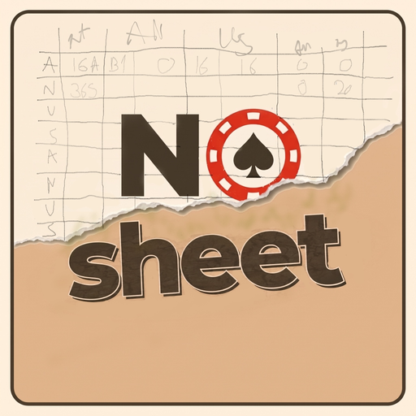

# 🃏 No Sheet

  

  <strong>No Sheet. No worries.</strong> 
  <em>Make custom scoresheets for any game.</em>

  

---

### The Problem

Every single game night, the exact same thing happens:
- Nobody can find a pen.
- The only paper is the back of an electric bill or a greasy pizza napkin.
- Someone is using a dried-out highlighter.
- And by round 6, nobody can read anyone's handwriting.

**No Sheet** fixes that. Pull it up on your phone in 2 seconds, type scores with your native keyboard, and get back to the game.

👉 **[Launch No Sheet in your browser](https://v33sergiulica.github.io/NoSheet/)** *(No install, no sign-up, 100% free)*

---

### What Makes It Fun & Useful

* ⚡ **Tap & Play Directly**: Open the link on your phone. Tap **"Add to Home Screen"** if you want it as a fullscreen offline app with its own icon.
* 🃏 **Presets for Game Nights**:
  * **Romanian Whist**: Automated deals (1-8-1 & 8-1-8), round calculations, and rotating dealer markers.
  * **Belota**: Official 7-column scorecards for 4 players in 2 teams, complete with contract, round/total points, and declarations.
  * *More classics on the way: Rentz, Bridge, Uno, Hearts...*
* ✏️ **Double-Tap Pen Strike**: Made a mistake or missed a bid? Double-tap or double-click any score box to strike through it with an authentic pen slash.
* 🖍️ **Table Doodles**: Waiting for that one slow friend to take their turn? Tap the crayon tool and doodle right over the scoresheet in vintage ink colors.
* 📐 **Custom Thickness (`2 1 2 1`)**: Type simple numbers like `2 1 2 1` to create slim columns for single-digit bids and wide columns for 3-digit scores.
* 🔄 **Rotating Dealer Tracker**: Never argue about whose turn it is to shuffle and deal.
* 💾 **100% Crash-Proof**: Every keystroke is saved immediately to your phone. Accidental reload? Tab closed? Phone died? Your match is right where you left it.
* ☕ **Warm Paper & Late-Night Espresso**: Cozy vintage parchment daylight mode and an eye-friendly espresso dark mode that won't blind anyone across the table.

---

  Ready for game night? Grab your phone and jump in: 
  <strong><a href="https://v33sergiulica.github.io/NoSheet/">https://v33sergiulica.github.io/NoSheet/</a></strong>

